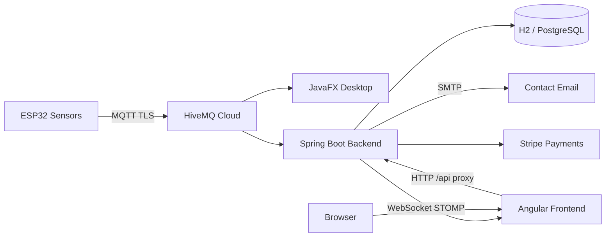

# Smart Irrigation Center — Project Guide

Complete reference for the **Smart Irrigation Center** monorepo: desktop app, web platform (AquaSense), backend API, and IoT integration.

---

## 1. Project overview

This project is a **smart irrigation management system** that monitors soil moisture, temperature, and humidity from ESP32 sensors over MQTT, displays real-time analytics, and supports remote valve control. It consists of three main parts:

| Component | Description |
|-----------|-------------|
| **Desktop app** | JavaFX application with SQLite — full dashboard, charts, settings, valve control |
| **Web app (AquaSense)** | Angular SPA + Spring Boot API — marketing site, auth, Pro subscription, sensor charts |
| **IoT firmware** | ESP32 code publishing sensor telemetry to HiveMQ Cloud |

Both the desktop and web backend connect to the **same MQTT broker and topics**, so sensor data is shared across platforms.

---

## 2. Architecture



### Data flow

1. ESP32 publishes JSON telemetry to `irrigation/device/esp32_01/telemetry`
2. Desktop app and web backend subscribe to the same topic
3. Web backend saves readings to the database and broadcasts via WebSocket (`/topic/sensors`)
4. Pro users on the web see live charts; the desktop app shows charts and home metrics locally

---

## 3. Technology stack

### Desktop (`/` root Maven project)

| Technology | Version / Notes |
|------------|-----------------|
| Java | 17 |
| JavaFX | 21 |
| SQLite | Local persistence |
| HiveMQ MQTT Client | 1.3.3 |
| Gson | JSON parsing |
| Maven | Build + `javafx:run` |

### Web backend (`backend/`)

| Technology | Version / Notes |
|------------|-----------------|
| Java | 21 |
| Spring Boot | 3.3.5 |
| Spring Security | JWT in HttpOnly cookies |
| Spring Data JPA | Hibernate |
| Spring Mail | SMTP contact form |
| Spring WebSocket | STOMP broker |
| HiveMQ MQTT Client | 1.3.3 |
| Stripe Java SDK | Pro subscriptions |
| H2 | Dev database (file) |
| PostgreSQL | Production database |
| Maven | Build |

### Web frontend (`frontend/`)

| Technology | Version / Notes |
|------------|-----------------|
| Angular | 17 (standalone components) |
| TypeScript | 5.4 |
| Chart.js | 4.x — sensor line charts |
| STOMP / SockJS | Live WebSocket updates |
| RxJS | Reactive streams |
| SCSS | Themed to match desktop green palette |

### Infrastructure & IoT

| Technology | Purpose |
|------------|---------|
| Docker Compose | PostgreSQL for production-like runs |
| HiveMQ Cloud | MQTT broker (TLS port 8883) |
| ESP32 firmware | `esp32_firmware/` |

---

## 4. Features

### Desktop application

- User login / signup (SQLite)
- **Home** — live sensor cards (temperature, humidity, soil moisture)
- **Charts** — three line charts (Temperature, Humidity, Soil Moisture), last 100 points
- **Settings** — MQTT broker configuration, valve open/close
- MQTT connection status in sidebar
- CSV export utilities

### Web application (AquaSense)

#### Public (no login)

| Page | Route | Description |
|------|-------|-------------|
| Landing | `/` | Product homepage |
| About | `/about` | Project information |
| Pricing | `/pricing` | Free vs Pro plans, Stripe checkout |
| Contact | `/contact` | Contact form → email + database |
| Login | `/login` | Sign in |
| Register | `/register` | Create account |

#### Authenticated

| Feature | Route | Access |
|---------|-------|--------|
| Checkout success | `/checkout/success` | Logged-in users after Stripe payment |
| **Charts** | `/charts` | **Pro subscription** or **Admin** |

#### Pro Charts page (`/charts`)

- Green sidebar matching desktop layout
- **Sensor Analytics** — three Chart.js line charts (same as desktop)
- Loads last 100 readings from API + live WebSocket updates
- MQTT connection status indicator

### Backend API capabilities

- JWT authentication (access + refresh tokens as HttpOnly cookies)
- User registration and roles (`USER`, `ADMIN`)
- Stripe Pro subscription checkout and activation
- MQTT bridge: telemetry → database → WebSocket
- Pro-only sensor history and valve commands
- Contact form with SMTP email notification

---

## 5. Project structure

```
smart-irrigation-center/
├── src/                          # JavaFX desktop app
│   ├── main/java/com/smartirrigation/
│   │   ├── MainApp.java
│   │   ├── controller/           # Login, Dashboard, Charts, Home, Settings
│   │   ├── service/MqttService.java
│   │   ├── dao/                    # SQLite data access
│   │   └── model/
│   └── main/resources/
│       ├── fxml/                   # UI layouts
│       └── css/style.css           # Green theme
│
├── backend/                      # Spring Boot API
│   ├── src/main/java/com/aquasense/
│   │   ├── controller/             # REST endpoints
│   │   ├── service/                # Auth, MQTT, Stripe, Mail, Sensors
│   │   ├── entity/                 # JPA entities
│   │   ├── security/               # JWT filter, cookies
│   │   └── config/
│   ├── src/main/resources/
│   │   ├── application.yml         # Base config
│   │   └── application-dev.yml     # Dev: H2, port 8081
│   ├── application-local.yml       # Gitignored secrets (Stripe, mail)
│   ├── .env                        # Gitignored env vars (loaded by run-dev.sh)
│   ├── run-dev.sh                  # Recommended dev startup script
│   └── pom.xml
│
├── frontend/                     # Angular SPA
│   ├── src/app/
│   │   ├── pages/                  # Landing, login, charts, contact, etc.
│   │   ├── layout/                 # Public + Pro layouts
│   │   ├── core/                   # Auth, API, guards, models
│   │   └── app.routes.ts
│   ├── proxy.conf.json             # Dev proxy → backend :8081
│   └── package.json
│
├── esp32_firmware/               # Arduino / ESP32 sensor code
├── docker-compose.yml            # PostgreSQL
├── pom.xml                       # Desktop Maven project
├── AQUASENSE.md                  # Short web platform summary
└── PROJECT_GUIDE.md              # This file
```

---

## 6. Prerequisites

| Tool | Version | Used for |
|------|---------|----------|
| Java JDK | 17 (desktop), 21 (backend) | Compile & run |
| Maven | 3.8+ | Desktop + backend builds |
| Node.js | 18+ | Angular frontend |
| npm | 9+ | Frontend dependencies |
| Docker | Optional | PostgreSQL via Compose |

---

## 7. How to run

### 7.1 Desktop application

```bash
# From project root
mvn javafx:run
```

**Default login:** `admin` / `admin123`

The desktop app connects to HiveMQ Cloud automatically (configured in `MqttService.java`).

---

### 7.2 Web platform (recommended local dev)

You need **two terminals**: backend + frontend.

#### Terminal 1 — Backend

```bash
cd backend

# First-time setup: copy secret templates
cp application-local.yml.example application-local.yml
cp .env.example .env
# Edit .env and application-local.yml with your Stripe keys and mail password

# Start (loads .env automatically)
chmod +x run-dev.sh
./run-dev.sh
```

Or manually:

```bash
cd backend
export SPRING_PROFILES_ACTIVE=dev,local
# export MAIL_PASSWORD=...  (if not using .env)
mvn spring-boot:run
```

| Service | URL |
|---------|-----|
| API | http://localhost:8081 |
| H2 Console | http://localhost:8081/h2-console |
| WebSocket | ws://localhost:8081/ws |

**Default web admin (Pro enabled):**

| Email | Password |
|-------|----------|
| `admin@aquasense.io` | `admin123` |

#### Terminal 2 — Frontend

```bash
cd frontend
npm install    # first time only
npm start
```

| Service | URL |
|---------|-----|
| Web app | http://localhost:4200 |

The dev server proxies `/api` and `/ws` to `localhost:8081` (see `proxy.conf.json`), so cookies and CORS work correctly.

---

### 7.3 Production-style run (PostgreSQL)

```bash
# Start database
docker compose up -d

# Backend (default profile, port 8080)
cd backend
export DB_HOST=localhost DB_PORT=5432 DB_NAME=aquasense DB_USER=aquasense DB_PASSWORD=aquasense
mvn spring-boot:run

# Frontend production build
cd frontend
npm run build
# Serve dist/frontend/ with any static host, proxy /api to backend
```

---

## 8. Configuration

### 8.1 Spring profiles

| Profile | Purpose |
|---------|---------|
| `dev` | H2 file DB, port **8081**, H2 console, debug mail logs |
| `local` | Loads `application-local.yml` (gitignored secrets) |
| (default) | PostgreSQL, port **8080** |

Local development uses: `SPRING_PROFILES_ACTIVE=dev,local`

### 8.2 Secret files (gitignored)

| File | Contents |
|------|----------|
| `backend/application-local.yml` | Stripe API key, mail settings |
| `backend/.env` | `MAIL_PASSWORD`, optional overrides |

`run-dev.sh` automatically sources `backend/.env`.

### 8.3 Environment variables

| Variable | Description | Default |
|----------|-------------|---------|
| `JWT_SECRET` | HMAC secret for JWT | Dev placeholder in `application.yml` |
| `CORS_ORIGINS` | Allowed frontend origin | `http://localhost:4200` |
| `MQTT_HOST` | HiveMQ broker host | HiveMQ Cloud host |
| `MQTT_PORT` | MQTT TLS port | `8883` |
| `MQTT_USERNAME` | Broker username | — |
| `MQTT_PASSWORD` | Broker password | — |
| `STRIPE_API_KEY` | Stripe secret key | Placeholder |
| `STRIPE_PRO_PRICE_ID` | Stripe Price ID for Pro | Placeholder |
| `STRIPE_WEBHOOK_SECRET` | Stripe webhook secret | Placeholder |
| `MAIL_ENABLED` | Enable contact email | `false` (true in local profile) |
| `MAIL_HOST` | SMTP host | `smtp.gmail.com` |
| `MAIL_PORT` | SMTP port | `587` |
| `MAIL_USERNAME` | SMTP login | — |
| `MAIL_PASSWORD` | SMTP password / App Password | — |
| `MAIL_TO` | Contact form recipient | `mohamed.gharsalli@etudiant-ipeiem.utm.tn` |
| `MAIL_FROM` | Sender address | Same as `MAIL_TO` |

### 8.4 MQTT topics

| Topic | Direction | Payload |
|-------|-----------|---------|
| `irrigation/device/esp32_01/telemetry` | Device → Server | `{ temperature, humidity, soilMoisture }` |
| `irrigation/device/esp32_01/command` | Server → Device | Valve open/close commands |

### 8.5 Stripe (Pro subscription)

1. Create a Stripe test account and a recurring **Price** ($29/month Pro)
2. Add to `backend/application-local.yml`:
   ```yaml
   aquasense:
     stripe:
       api-key: sk_test_...
       pro-price-id: price_...
   ```
3. User flow: **Pricing → Upgrade → Stripe Checkout → `/checkout/success` → Pro activated**

### 8.6 Contact form email (SMTP)

Contact messages are saved to the database **and** emailed to the configured recipient.

**Current recipient:** `mohamed.gharsalli@etudiant-ipeiem.utm.tn`

For Google-hosted mailboxes (UTM student email):

1. Enable **2-Step Verification** on your Google account
2. Create an **App Password**: https://myaccount.google.com/apppasswords
3. Set in `backend/.env`:
   ```bash
   MAIL_PASSWORD=your16charapppassword
   ```
4. Restart backend with `./run-dev.sh`

> **Note:** Google rejects normal login passwords for SMTP. You must use an App Password.

---

## 9. API reference

Base URL (dev): `http://localhost:8081/api`

### Public

| Method | Endpoint | Description |
|--------|----------|-------------|
| GET | `/public/info` | Project metadata |
| GET | `/public/pricing` | Pricing plans JSON |
| POST | `/contact` | Submit contact form |
| POST | `/auth/register` | Register user |
| POST | `/auth/login` | Login (sets cookies) |
| POST | `/auth/refresh` | Refresh access token |
| POST | `/auth/logout` | Logout |
| GET | `/auth/me` | Current user profile |

### Pro (requires login + active Pro or Admin)

| Method | Endpoint | Description |
|--------|----------|-------------|
| GET | `/pro/sensors?page=0&size=50` | Recent sensor readings |
| GET | `/pro/connection` | MQTT broker connection status |
| POST | `/pro/valve` | Send valve command `{ "action": "OPEN" \| "CLOSE" }` |

### Subscription

| Method | Endpoint | Description |
|--------|----------|-------------|
| POST | `/subscription/checkout` | Create Stripe checkout session |
| POST | `/subscription/complete?session_id=...` | Verify payment, activate Pro |

### WebSocket

| Endpoint | Protocol | Topic |
|----------|----------|-------|
| `/ws` | STOMP over SockJS | Subscribe: `/topic/sensors` |

---

## 10. Web routes

| Route | Guard | Page |
|-------|-------|------|
| `/` | — | Landing |
| `/about` | — | About |
| `/contact` | — | Contact form |
| `/pricing` | — | Pricing + Stripe |
| `/login` | guest | Login |
| `/register` | guest | Register |
| `/checkout/success` | auth | Post-payment confirmation |
| `/charts` | auth + pro | Sensor analytics charts |

---

## 11. Access tiers

| Tier | Web access |
|------|------------|
| **Public** | Landing, about, contact, pricing, register |
| **Free (logged in)** | Same as public + can upgrade to Pro |
| **Pro** | Charts page, live sensor data, MQTT status |
| **Admin** | All Pro features (no subscription required) |

---

## 12. UI theme

Both desktop and web share the same green irrigation palette:

| Color | Usage |
|-------|-------|
| `#1B5E20` | Primary dark / sidebar |
| `#2E7D32` | Primary |
| `#43A047` | Accent, buttons |
| `#66BB6A` | Light accent |
| `#e8f5e9` / `#f8fdf8` | Background gradient |
| `#ff6d00` | Chart line color (desktop + web) |

---

## 13. Troubleshooting

### Frontend shows blank / black page

- Hard refresh: **Cmd+Shift+R**
- Restart: `cd frontend && npm start`
- Charts code is lazy-loaded; public pages should load without Chart.js

### `EMFILE: too many open files` (frontend)

- `npm start` uses `--poll 2000` to reduce file watcher load
- Or increase macOS limit: `ulimit -n 10240`

### Backend port 8081 already in use

```bash
lsof -ti:8081 | xargs kill -9
cd backend && ./run-dev.sh
```

### Contact form: "Failed to send message"

- Check backend logs for SMTP errors
- Ensure `aquasense.mail.enabled=true` in `application-local.yml`
- Use a **Gmail App Password**, not your normal password
- Start backend with `./run-dev.sh` (loads `.env`)

### Charts page empty

- Log in as Pro user (`admin@aquasense.io` / `admin123`)
- Ensure backend is running and MQTT is connected (sidebar shows status)
- Navigate to http://localhost:4200/charts

### MQTT not connected

- Verify HiveMQ credentials in `application.yml` / `application-dev.yml`
- Ensure ESP32 is publishing to the telemetry topic
- Check backend log: `MQTT connected`

---

## 14. Build commands

```bash
# Desktop
mvn clean package
mvn javafx:run

# Backend
cd backend && mvn clean package
java -jar target/aquasense-backend-1.0.0-SNAPSHOT.jar

# Frontend
cd frontend && npm run build
# Output: frontend/dist/frontend/
```

---

## 15. What was built (summary)

| Area | Deliverable |
|------|-------------|
| Desktop | Full JavaFX irrigation dashboard with MQTT, charts, valve control, SQLite |
| Web backend | Spring Boot REST API, JWT auth, Stripe Pro, MQTT bridge, WebSocket, SMTP contact |
| Web frontend | Angular 17 AquaSense site with public pages, auth, Pro charts matching desktop |
| IoT | ESP32 firmware publishing sensor JSON to HiveMQ |
| DevOps | Docker Compose for PostgreSQL, dev proxy, H2 for local dev |
| Integration | Shared MQTT topics between desktop, web backend, and ESP32 |

---

## 16. Default credentials quick reference

| System | Username / Email | Password |
|--------|------------------|----------|
| Desktop app | `admin` | `admin123` |
| Web app (Admin/Pro) | `admin@aquasense.io` | `admin123` |

---

*Last updated: May 2026*
